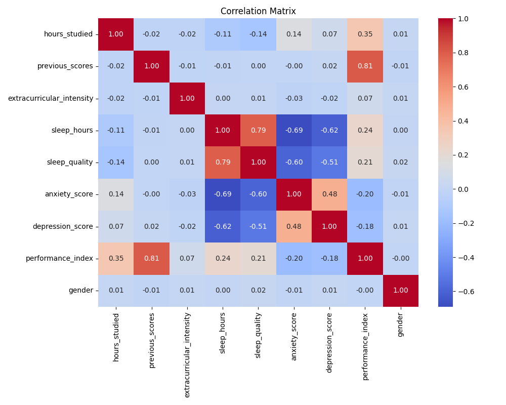
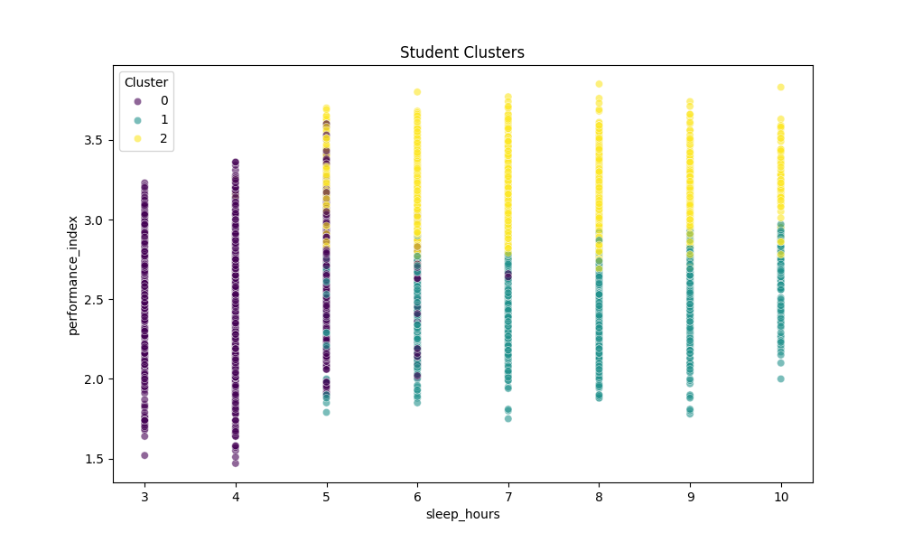
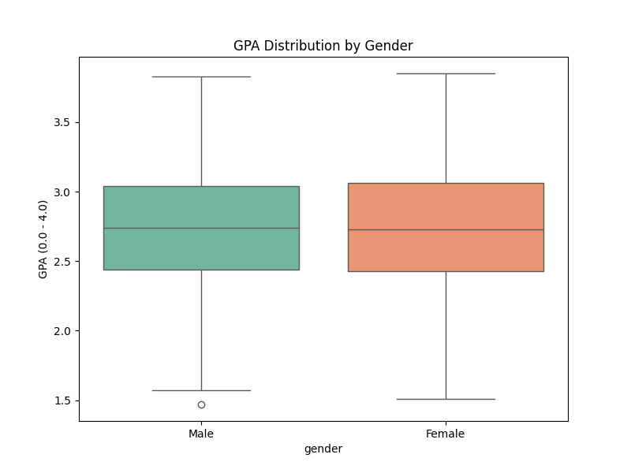
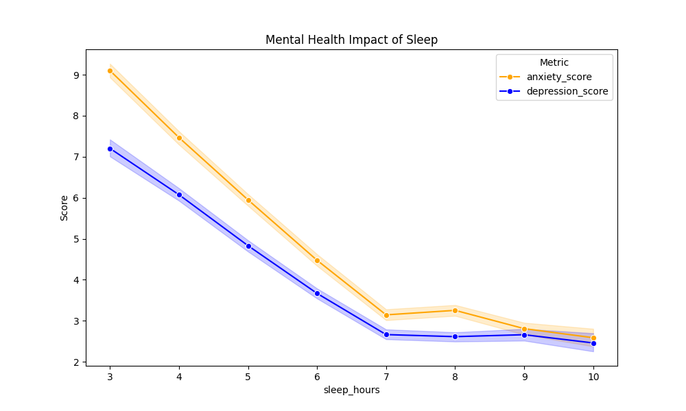

# Student Performance Analytics

Analysis of how sleep and student habits relate to performance, using correlation analysis, K-means clustering, and gender comparisons, with a PHP web dashboard for exploring the results.

## Dataset
- `Student_Performance.csv`: student records with sleep hours, study habits, and a performance index.
- `sleepstudy.sqlite`: the SQLite database the analysis and dashboard read from (table `student_performance`).

## Questions
1. How does sleep relate to performance?
2. Do students fall into distinct groups (clustering)?
3. How does performance compare by gender?

## Analysis
- `analysis.py`: loads the table from SQLite, builds a correlation matrix, a gender boxplot, and a K-means clustering with 3 clusters, then saves the charts and writes `model_metrics.txt`.
- `classify_activity.py`: a keyword-based scorer that rates extracurricular activity text from None to High. It is rule-based, not a trained model.
- `prepare_data.py`, `mental_model.py`, `sentiment.py`: supporting scripts.

## Results
Average performance index by sleep hours (from `model_metrics.txt`):

| Sleep hours | Avg. performance index |
|---|---|
| 3 | 2.48 |
| 6 | 2.82 |
| 10 | 2.86 |

Performance rises only slightly as sleep increases, and this is a correlation, not proof that sleep causes better performance.

## Dashboard
The PHP pages (`index.php`, `explore.php`, `insights.php`, `assessment.php`, `about.php`) read from `sleepstudy.sqlite` through `db.php`.

## How to Run
1. Install Python packages: `pip install pandas matplotlib seaborn scikit-learn`
2. Run the analysis: `python analysis.py`
3. Start the PHP server from the project folder: `php -S localhost:8000`
4. Open `http://localhost:8000` in your browser.

## Limitations
- Results are correlations from a single dataset.
- The classifier in `classify_activity.py` is keyword-based.
